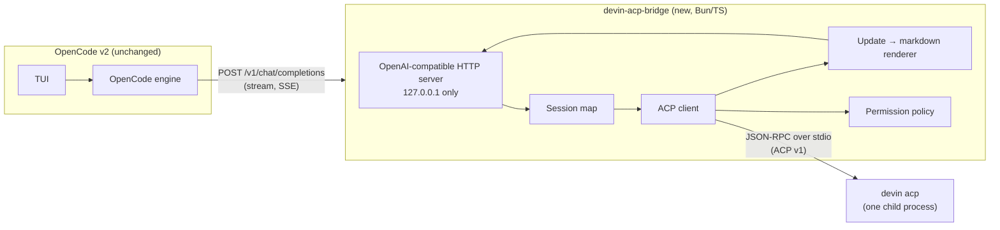

# Spec: Devin in the OpenCode TUI via a local ACP bridge (basic demo)

- **Status:** Demo complete. M0–M5 done (see §8 and §11).
- **Date:** 2026-11-04
- **Owner:** Jason Kang
- **Scope:** Personal tooling demo. Not a Tradify product change.

## 1. Problem

Devin CLI (3000.11.234) renders assistant replies poorly in the terminal: no syntax highlighting in fenced
code, and weak styling of headers, lists, bold and italics. OpenCode (v2.2.5) renders the same markdown well
in the same tmux pane, so the terminal is not the cause.

Devin can run as an ACP agent (`devin acp`). OpenCode can only be an ACP **agent**, not an ACP **client**,
so it cannot host `devin acp` directly. The upstream request for this (anomalyco/opencode#28991) was
auto-closed for inactivity, not rejected.

## 2. Goal

Type a prompt in the OpenCode TUI, have **Devin** do the work, and see Devin's reply rendered by OpenCode.

### Success criteria (demo)

1. A prompt sent from the OpenCode TUI reaches `devin acp`, and Devin's reply streams back into the TUI.
2. Markdown in the reply (headers, lists, bold, fenced code with highlighting) renders as well as a normal
   OpenCode reply.
3. A follow-up prompt in the same OpenCode session continues the same Devin session (Devin remembers context).
4. Devin's tool activity (file reads, edits, shell commands), plans and diffs are visible in the TUI.
5. No Devin tool call is approved automatically unless the user allowed it in advance.
6. Pressing escape/cancel in OpenCode cancels the Devin turn.

### Non-goals

- No fork of OpenCode. No change to the OpenCode source.
- ~~No native OpenCode tool cards, diff/revert or snapshots for Devin's changes.~~ Revert works without bridge
  changes (§11.15); tool cards are opt-in (§6.16). By default Devin's activity appears as formatted text.
- ~~No OpenCode-side model picker for Devin models.~~ Added after the demo; see §6.10.
- No session list/resume across OpenCode restarts.
- ~~No interactive permission prompt inside the OpenCode UI.~~ Added in §6.13.
- Not a supported product. It relies on public interfaces of both tools, which can change.

## 3. Key design decision: a local OpenAI-compatible bridge, not a fork

Verified facts that drive the design:

| Fact | Source |
| --- | --- |
| OpenCode v2 custom providers accept `"package": "@opencode/ai/providers/openai-compatible"` with a `settings.baseURL`. | opencode.ai/v2/docs/providers ("Custom") |
| OpenCode v2 provider packages implement OpenCode's **own** `LanguageModel` (export `model(modelID, settings)`), not the Vercel AI SDK `LanguageModelV3`. | `packages/ai/src/provider-package.ts` on `anomalyco/opencode@dev` |
| So the existing `@mcpc-tech/acp-ai-provider` (AI SDK `LanguageModelV3`) cannot be plugged into OpenCode v2 directly. | Same as above |
| `devin acp` speaks ACP v1, newline-delimited JSON-RPC over stdio, and uses `devin auth login` credentials. | Devin CLI docs `reference/commands.mdx` (`devin acp`) |

The bridge therefore exposes an **OpenAI Chat Completions** endpoint on `127.0.0.1` and acts as an
**ACP client** to `devin acp`. OpenCode treats Devin as "just another model".

Alternatives considered:

| Option | Why not (for the demo) |
| --- | --- |
| Fork OpenCode and add an ACP client to its engine | Large; merge conflicts on every OpenCode release. |
| Custom OpenCode provider package (own `LanguageModel`) | Couples to OpenCode's internal Effect-based model API, which is not documented for third parties. Revisit after the demo. |
| Re-implement OpenCode's server API and use `opencode --server <url>` | Much larger API surface; undocumented. |
| CodeCompanion.nvim + `devin acp` | Works today without code. This spec is the OpenCode-specific alternative. |

## 4. Architecture



Request flow for one turn:

1. OpenCode sends the full conversation to `POST /v1/chat/completions` with `stream: true`.
2. The bridge maps the conversation to a Devin ACP session (§6.2). It creates the session on the first turn.
3. The bridge sends **only the newest user message** to Devin with `session/prompt`.
4. Devin streams `session/update` notifications. The bridge converts each one to markdown text (§6.3) and
   writes it as an SSE `chat.completion.chunk` with `delta.content`.
5. Devin may send `session/request_permission`. The bridge answers from its policy (§6.5).
6. When `session/prompt` resolves, the bridge sends a final chunk with `finish_reason` and `data: [DONE]`.

## 5. Components

### 5.1 `devin-acp-bridge` (new)

- **Runtime:** Bun (installed: 1.3.14) with TypeScript. Single entry file plus a few modules. Node 24 also works.
- **ACP library:** `@agentclientprotocol/sdk` (`ClientSideConnection`). The latest release (2.4.0) was
  published on 2026-11-02, which is less than 7 days ago. **Pin the newest version that is at least 7 days
  old**, and pin an exact version (no `^`).
- **HTTP:** `Bun.serve`. No framework.
- **Location:** `~/src/personal/devin-acp-bridge/` (personal repo, not a Tradify repo).

### 5.2 OpenCode configuration (no code change)

Global config `~/.config/opencode/opencode.jsonc`, or a project-level `opencode.jsonc`. Every field below was
checked against https://opencode.ai/config.json and exercised against the M0 stub (§11). The working copy is
`sandbox/opencode.jsonc`.

```jsonc
{
  "$schema": "https://opencode.ai/config.json",
  "providers": {
    "devin": {
      "name": "Devin (ACP bridge)",
      "package": "@opencode/ai/providers/openai-compatible",
      // Set per project: the bridge uses it as the Devin session cwd (§6.6).
      "headers": { "X-Devin-Cwd": "/absolute/path/to/project" },
      "settings": {
        "baseURL": "http://127.0.0.1:7317/v1",
        // Read the bridge token from its file; works in OpenCode's background service, unlike shell env.
        "apiKey": "{file:~/.config/devin-acp-bridge/token}",
        // Devin turns can be long and quiet while tools run.
        "chunkTimeout": false
      },
      "models": {
        "devin": {
          "name": "Devin",
          // Shows Devin's thoughts as OpenCode reasoning blocks.
          "compatibility": { "reasoningField": "reasoning_content" },
          // ACP reports no token usage; a large limit keeps OpenCode from compacting.
          "limit": { "context": 1000000, "output": 128000 }
        }
      }
    }
  },
  "agents": {
    "devin": {
      "description": "Send prompts to Devin through the local ACP bridge",
      "mode": "primary",
      // No "model" here: an agent model pin would override the model picked in /models.
      "permissions": [
        { "action": "edit", "resource": "*", "effect": "deny" },
        { "action": "shell", "resource": "*", "effect": "deny" }
      ]
    }
  },
  "compaction": { "auto": false },
  // Live Devin model list (§6.10). Options: baseURL, provider, exclude, refreshMinutes.
  "plugins": ["/absolute/path/to/devin-acp-bridge/opencode-plugin"]
}
```

Use: start the bridge, run `opencode`, and switch to the `devin` agent.

An agent `system: ""` and a model `capabilities.tools: false` do **not** stop OpenCode from sending its own
system prompt (about 80 KB) and tool definitions (§11). The bridge ignores both, so the config leaves those
settings out. The agent's edit/shell deny rules stay as a safety net.

## 6. Detailed design

### 6.1 Process lifecycle

- The bridge starts **one** `devin acp` child process on its first request and reuses it for all sessions.
- On start it sends `initialize` with `protocolVersion: 1` and
  `clientCapabilities: { fs: { readTextFile: false, writeTextFile: false }, terminal: false }`. Devin then uses
  its own file and shell tools, and the bridge does not touch the filesystem.
- If the child exits, the bridge clears all sessions, logs the exit code, and restarts the child on the next
  request. The in-flight OpenCode request gets an error chunk.
- On SIGINT/SIGTERM the bridge closes the child's stdin and exits.

### 6.2 Session mapping

OpenAI-style requests are stateless: OpenCode resends the whole history every turn. OpenCode does send its
session ID in the `x-opencode-session` header (also `x-opencode-session-id`, `x-session-id`) (§11).

- **Session key:** the `x-opencode-session` header. Fallback, if the header is missing: SHA-256 of the
  **first user message** text plus the cwd (§6.6).
- **First turn** (no entry for the key): `session/new` with `cwd` = an absolute path (§6.6) and
  `mcpServers: []`. Store `key → { sessionId, userTurns }`.
- **Next turn** (the request has exactly `userTurns + 1` user messages): reuse the stored `sessionId`. Send
  only the last `user` message.
- **Anything else** (OpenCode edited, retried or reverted history; or the bridge restarted, or `devin acp`
  restarted and the bridge forgot its sessions): start a new Devin session and send a transcript of the earlier
  user/assistant turns plus the latest user message (`transcriptPrompt` in `src/sessions.ts`).
- **System messages:** drop them. Devin has its own system prompt, and OpenCode's prompt describes tools that
  Devin does not have.
- **`tools` array:** ignore it, except `question` (§6.12) and the plugin's `devin_tool` (§6.16). OpenCode sends
  its tool definitions on every main-chat request (§11).
- **Title requests:** never sent to Devin. The bridge waits up to 20 s for Devin's own title for the OpenCode
  session (`session_info_update`, also after the turn ended), then falls back to the first five words of the
  prompt (§7, §11.12).
- **Image parts:** `image_url` parts with a base64 `data:` URL on the newest user message go to Devin as ACP
  `image` blocks after the text (`promptCapabilities.image: true`). Remote URLs and images on earlier messages
  are dropped; a transcript replay carries text only.
- Sessions live in memory only. A bridge restart starts fresh Devin sessions.

### 6.3 ACP update → markdown mapping

Everything is emitted as **text content**. The bridge never emits OpenAI `tool_calls`, because OpenCode would
try to execute them.

| ACP `session/update` | Emitted markdown |
| --- | --- |
| `agent_message_chunk` (text) | The text, as is. |
| `agent_thought_chunk` | Emitted as `delta.reasoning_content`. OpenCode shows it as a reasoning block when the model sets `compatibility.reasoningField` (verified in M0). |
| First `tool_call`/`tool_call_update` for an ID | One line: `> **Run** \`<command>\`` for `execute` tools; otherwise `> **<title>** \`<path>\`` (up to 3 paths, relative to the cwd when inside it). |
| `execute` tool finishes (`completed` or `failed`) | The latest streamed output, first 20 lines, in a ` ```text ` fence. Devin streams output in `in_progress` updates and sends an empty `completed` update; `Exited with code N` placeholders are hidden. A non-zero `_meta.terminal_exit.exit_code` adds `> ✗ **<title>** exited with code N`. |
| Other tool `failed` | `> ✗ **<title>** failed: <first line of error>`. Skipped when the bridge itself rejected the permission. |
| Tool content of type `diff` | The path, then a ` ```diff ` block (unified diff, 3 lines of context, at most 80 lines). Rendered once per tool call and path, although Devin repeats it. |
| `plan` | `**Plan**` and a task list: `- [x]` completed, `- [ ] **…** _(in progress)_`, `- [ ]` pending. The first plan appears at once; the final plan appears at the end of the turn if it changed. |
| `usage_update` | Not shown. The last top-level one becomes the OpenAI `usage` (§6.4). |
| `available_commands_update`, `current_mode_update`, `config_option_update`, `session_info_update` | Not shown. |

Rules:

- Insert a blank line before and after every block element, so OpenCode's markdown parser does not merge a
  tool line into the previous paragraph.
- Track whether a fenced code block is open in the agent's own text. Never insert tool lines inside an open
  fence; queue them until the fence closes (splitting the chunk right after the closing fence line) or the
  turn ends (closing the fence first).

### 6.4 Stop reasons

| ACP `stopReason` | OpenAI `finish_reason` |
| --- | --- |
| `end_turn` | `stop` |
| `max_tokens` | `length` |
| `max_turn_requests` | `length` |
| `refusal` | `content_filter` |
| `cancelled` | `stop` (plus a final `_Cancelled._` line) |

`usage` comes from Devin's last top-level `usage_update` in the turn: `prompt_tokens` =
`_meta["cognition.ai/inputTokens"]` (falls back to `used`), `completion_tokens` =
`_meta["cognition.ai/outputTokens"]`. Updates with `_meta["cognition.ai/subagent_context"]` are ignored.

### 6.5 Permissions

`@mcpc-tech/acp-ai-provider` auto-selects the **first** permission option by default. The bridge must not do
that. Policy, in order:

1. **Devin's own config decides first.** Devin only sends `session/request_permission` for calls its own rules
   do not already allow or deny. Configure safe allows (reads, searches, `git status`, `dotnet build`, …) in
   `~/.config/devin/config.json` permissions.
2. **Bridge policy file** `~/.config/devin-acp-bridge/policy.json` (override with `DEVIN_BRIDGE_POLICY`),
   read again on every request, so edits apply without a restart:

   ```json
   {
     "rules": [
       { "command": "git push*", "decision": "reject" },
       { "command": "git *", "decision": "allow" },
       { "rule": "Exec(dotnet)", "decision": "allow" }
     ]
   }
   ```

   `command` matches `_meta["cognition.ai/editableCommand"]`, `rule` matches
   `_meta["cognition.ai/permissionRule"]`, `title` matches `toolCall.title`. Patterns are globs where only `*`
   is special. Every given field must match; a rule with no match field never matches. First match wins.
   A missing or invalid file means no rules.
3. **`allow` selects `allow_once` only.** Never `allow_always`, `allow_session`, `allow_always_global` or
   `switch_bypass`. If Devin offers no `allow_once`, the request is rejected.
4. **`allow` never covers a chained command.** A command containing `;`, `&`, `|`, `<`, `>`, a backtick, `$(`
   or a newline is rejected even when an allow rule matches, because `git *` would otherwise match
   `git status && rm -rf ~`.
5. **Ask the user when no rule decides** (§6.13). Reasons `no matching rule` and `chained command` go to a
   prompt in OpenCode if Devin offers `allow_once`. A `reject` rule and `no allow-once option` never prompt.
6. **Default: reject.** When the bridge cannot prompt, pick the option whose `kind` is `reject_once` (then
   `reject_always`). If none exists, return `outcome: "cancelled"`.
7. Every decision is emitted into the reply as `> **Permission** allowed: \`<command>\``,
   `> **Permission** rejected by bridge policy (<reason>): \`<command>\``, or
   `> **Permission** allowed by you` / `rejected by you` after a prompt. The reason is `no matching rule`,
   `reject rule`, `chained command` or `no allow-once option`. Devin itself reports every reject to its model
   as "User rejected this tool call", so this line is the only place that shows the bridge decided.

### 6.6 Working directory

The bridge needs an absolute `cwd` for `session/new`. OpenCode's requests do not carry its working directory
(`x-opencode-project` was `global` in M0). Demo approach, in order:

1. `X-Devin-Cwd` header. A project-level `opencode.jsonc` provider `headers` entry reaches the bridge
   (verified in M0). The bridge rejects a relative path or a path that does not exist.
2. Otherwise the bridge's own `cwd`. Start the bridge from the project directory.

### 6.7 Cancellation

If OpenCode closes the HTTP connection before the turn ends, the bridge sends `session/cancel` for that
session. The session stays busy until `session/prompt` resolves. A request for a busy session waits up to 5 s,
then gets HTTP 409.

If `devin acp` exits mid-turn, the open turn ends with
`_The bridge could not complete the Devin turn: …_`, the session map is cleared, and the next request starts a
new child and a new Devin session with the transcript (§6.2).

### 6.8 Security

- Bind to `127.0.0.1` only (hard-coded).
- Every `/v1/*` request needs `Authorization: Bearer <token>`, compared in constant time. The token is
  `DEVIN_BRIDGE_TOKEN` when set; otherwise the bridge creates `~/.config/devin-acp-bridge/token` once (mode
  `0600`). OpenCode reads the file with `"apiKey": "{file:~/.config/devin-acp-bridge/token}"`, which also
  works in OpenCode's background service, where shell variables are often missing. The token is never logged.
- The bridge never reads Devin credentials. `devin acp` uses its own `devin auth login` store.
- Prompts and replies are logged only with `DEVIN_BRIDGE_DEBUG=1`, to
  `~/.cache/devin-acp-bridge/bridge-debug.ndjson`, never to stdout.
- AI policy: no new AI vendor or model is involved. All inference still goes through Devin, the approved tool.

### 6.9 Endpoints

| Method | Path | Behaviour |
| --- | --- | --- |
| `GET` | `/v1/models` | Live Devin models (§6.10): `{ default_model, data: [{ id, name, object, owned_by, thought_levels?, default_thought_level? }] }`, first entry `devin`. 502 when Devin cannot be asked. |
| `POST` | `/v1/chat/completions` | Streaming (SSE). Non-streaming requests: buffer the same output and return one completion. |
| `GET` | `/v1/commands` | Devin's slash commands for the `X-Devin-Cwd` project (§6.15): `{ data: [{ name, description, hint? }] }`. |
| `POST` | `/v1/steer` | `{ session, text }` from the plugin (§6.14): `{ steered: true }` or `{ steered: false, reason }`. |
| `GET` | `/healthz` | `{ status, pid, build, devin: "running" \| "stopped", sessions, busy, waitingForAnswer }`. No auth. No session content. |

### 6.10 Model selection

OpenCode never calls `GET /v1/models` on an OpenAI-compatible provider (§11.1), so the model list comes from a
server plugin, `opencode-plugin/index.ts`.

- **Bridge catalog.** Devin reports its models only per session, as the `model` config option. The bridge reads
  them from every real `session/new`; while idle it refreshes at most every 15 min with a throwaway session
  that it deletes again. A `devin acp` restart clears the catalog.
- **Plugin.** On load (waiting up to 15 s for the first fetch) and every `refreshMinutes` (default 5) it fetches
  `/v1/models` with the bridge token (`DEVIN_BRIDGE_TOKEN`, else `~/.config/devin-acp-bridge/token`), drops
  IDs matching `exclude` (default `["fusion-*"]`), and registers the rest under the `devin` provider with
  `ctx.model.transform`. Each model is a copy of the configured `devin` model, so its limits and
  `compatibility` apply. A provider transform does not work: it cannot see providers defined in
  `opencode.jsonc`. A failed fetch keeps the current list and writes to
  `~/.cache/devin-acp-bridge/opencode-plugin.log`.
- **Per request.** The bridge reads `body.model`. `devin` means the model the session started with. Any other
  value is set with `session/set_config_option` (`configId: "model"`) when it differs from the session's
  current model, so switching mid-conversation applies to the next turn. Devin rejects an unknown value; the
  bridge returns 400 and deletes the session if it had just created it.
- **Thought level.** Each model ID includes its default thought level (`claude-opus-5-5-medium`,
  `swe-2-high`). Choosing a model resets `thought_level` to that default; the allowed levels differ by model,
  and `adaptive` has none (§11.4).
  - The bridge learns each model's levels from `session/set_config_option` responses. After the first
    `/v1/models` call it switches one throwaway session through every model in the background (about 30 s
    for 50 models, no prompt, not billed). `/v1/models` then adds `thought_levels` and `default_thought_level`.
  - The plugin registers one OpenCode variant per level (`-m devin/<model>#high`, or the TUI variant picker). It
    re-fetches 45 s after load, so the variants appear without waiting for the 5 min refresh.
  - The `model.request` hook sends the variant as `X-Devin-Thought-Level`. OpenCode reports `default` when no
    variant is chosen; that sends nothing (`thoughtLevelFor`).
  - The bridge applies the level with `configId: "thought_level"` after the model, only when it changes. A
    level the current model lacks is ignored, so the model's default applies.

### 6.11 Session mode per OpenCode agent

- **Plugin.** A `ctx.session.hook("model.request", …)` scoped to the `devin` provider sets
  `X-OpenCode-Agent: <agent id>` on every request. OpenCode's request body and headers carry no agent otherwise
  (§11.1).
- **Bridge** (`src/modes.ts`). `build` → Devin mode `bypass`; `plan` → Devin mode `plan`. Any other agent (for
  example the `devin` agent in the README) or no header → the mode the session started with (`accept-edits`).
  The bridge sends `session/set_config_option` (`configId: "mode"`) before the turn, only when the mode differs
  from the session's current mode, so switching agents mid-conversation applies to the next turn. A rejected
  value returns 400, as for models.
- **`bypass` turns off the bridge policy.** Devin sends no `session/request_permission` in `bypass`, so the
  policy file, the chained-command guard and the `> **Permission**` lines do not apply to `build`.

### 6.12 Questions (Devin's `ask_user_question` → OpenCode's `question` tool)

- **Capability.** `initialize` advertises `clientCapabilities.elicitation: { form: {} }`. Without it Devin hides
  its `ask_user_question` tool (§11.10). Devin sends each question call as one `elicitation/create` request
  and blocks the turn until the client replies.
- **Mapping** (`src/questions.ts`). One form field per question: `string` + `oneOf`/`enum` → single choice,
  `array` + `items.anyOf` → `multiple: true`, `boolean` → Yes/No, other types → no options (OpenCode always
  adds "Type your own answer"). Option label = `const`, description = `title` when it differs. Header =
  field `title`, clipped to 30 characters.
- **Pause** (`src/turn.ts`). A `Turn` owns one `session/prompt` and can span several HTTP responses. On a
  question it ends the current response with one `question` tool call (`finish_reason: "tool_calls"`) and
  parks the turn by OpenCode session key. Devin output that arrives while parked is buffered.
- **Resume.** The next request for the key is checked before session planning (§6.2):
  - It ends with the `tool` result for the parked call ID (OpenCode harness messages may follow it): the
    bridge parses OpenCode's `User has answered your questions: "<q>"="<a>, <b>"…` text against the questions
    it sent, replies `accept` with values typed per field (custom text passes through; Devin sets
    `cognition.ai/allowOther`), and streams the rest of the same Devin turn into this response. Any other
    tool result text (a dismissal or an error) replies `cancel`; Devin continues without an answer.
  - Anything else (a new user message, a retry): the bridge replies `cancel`, sends `session/cancel`, waits
    for the turn to end, then plans the request as usual.
- **Fallbacks.** If the request did not offer the `question` tool (the agent denies it), or the form is not
  mappable, the bridge replies `cancel` at once and adds `> **Question** cancelled: …` to the reply. A parked
  turn with no answer after `DEVIN_BRIDGE_QUESTION_TIMEOUT_MS` (default 10 min) is cancelled the same way. A
  tool result that arrives after the timeout is planned like any request, so it starts a new Devin session
  with the transcript.
- **Disconnect.** Cancel on disconnect (§6.7) applies only while a response is attached to the turn, not
  while it is parked.

### 6.13 Permission prompts

- **When.** `decidePermission` marks a request `askable` when no rule matched, or an `allow` rule matched a
  chained command, and Devin offers `allow_once` (§6.5 item 5). `DevinAgent` then holds the
  `session/request_permission` open and sends a `permission-ask` event to the turn.
- **Prompt.** The turn pauses exactly as for a question (§6.12), with one OpenCode `question`: header
  `Permission`, text `Allow Devin to use \`<label>\`? Paths: …. Tool: <kind>. Devin rule: <rule>. Bridge
  policy: <reason>.` (missing parts left out), options `Allow once`, `Always allow this command` (only when
  `alwaysAllowRule` gives a rule: a plain command, no `*`, reason `no matching rule`) and `Reject`.
- **Answer.** Only the single label `Allow once` or `Always allow this command` selects Devin's `allow_once`
  option (never an `allow_always` option, so never `switch_bypass`). `Always` also appends
  `{ "command": "<exact command>", "decision": "allow" }` to the policy file (atomic write; an invalid file is
  left as it is and the reply says the rule was not saved). `Reject`, custom text, a dismissal, a new message
  and the timeout all send the policy's reject response. The reply gets `> **Permission** allowed by you` or
  `rejected by you`, and for `Always` a line that the rule was added.
- **Fallback.** If the request did not offer the `question` tool, the bridge rejects at once with the usual
  policy line. A second question or permission that arrives while the turn is paused waits in order and is
  asked in the next response (`Turn` output queue).
- **Timeout** is `DEVIN_BRIDGE_QUESTION_TIMEOUT_MS`, shared with questions. `build` runs in `bypass` mode, so
  Devin sends no permission requests there and this section does not apply (§6.11).

### 6.14 Messages sent while Devin works (steering)

- **OpenCode.** A message typed during a turn is enqueued with delivery `steer` (the default) and delivered
  at the next step boundary. One Devin turn is one step, so without help it waits until Devin finishes.
- **Plugin.** It subscribes to `session.inbox.enqueued` and posts `{ session, text }` of each `steer` user item
  for its own directory to `/v1/steer`. `queue` items are left alone. The subscription retries every 5 s.
- **Bridge.** If a turn runs for `opencode:<session>`, it sends the text to Devin as a second `session/prompt`
  (Devin advertises `cognition.ai/midTurnPrompts` and reads it at its next step, §11.13), ends the attached
  response with `stop`, and parks the turn with the steer text. OpenCode then delivers the message; a request
  whose newest user text equals the steer text resumes the same turn, and the bridge records the extra user
  turn. If a tool card (§6.16) already ended the response, the same applies to the request that carries the
  card result and the steer message together. While a question waits, the bridge does not steer.

### 6.15 Devin slash commands

- **Bridge.** `/v1/commands` returns Devin's `available_commands_update` for the project's cwd (a throwaway
  session at first, then the latest update from real sessions; cached 15 min). `bridgeCommands` keeps the
  `Session` and `Skills` categories and drops mode switches (`ask`, `plan`, `code`, `smart`, `bypass`, `fast`;
  the agent sets the mode), `help`, `share`, `rename` and `goal` (it keeps working after the turn ends, and the
  bridge drops that output).
- **Plugin.** It registers each as `/devin:<name>` with `ctx.command.transform`. Running one sends
  `/<name> <args>` as a user prompt to the session; Devin reads the command from the prompt text. Plugin
  option `commands: false` turns this off.

### 6.16 Tool cards (opt-in)

- **Plugin option `toolCards: true`.** The plugin registers `devin_tool` (`codemode: false`, so it is a
  top-level tool). Its `execute` returns the card's `output` and sets `metadata.title`; it runs nothing.
- **Bridge.** When the request offers `devin_tool`, `TurnRenderer` holds each tool's markdown back and, when
  the tool finishes, produces a card `{ title, output }`: `Run <command>` or `<title> <paths>`, with shell
  output (200 lines), diffs and a non-zero exit code. The turn ends the response with one `devin_tool` call
  per card; the request that carries its result resumes the turn, as for questions. Rejected calls, and
  tools still running at the end of the turn, stay markdown. A later request without the tool gets the card
  as markdown.
- **Cost.** Each finished Devin tool is one more OpenCode step and one localhost round trip. An agent step
  limit can end OpenCode's loop early; the parked turn is then cancelled at the question timeout.

## 7. Known side effects in OpenCode

| Behaviour | Effect | Mitigation for the demo |
| --- | --- | --- |
| OpenCode generates session titles with a model call to the same model, in the same session (verified in M0) | Would start a second Devin turn per session. | Bridge detects the title request and answers with Devin's own title, or the first five words of the user's first message (§6.2). Detection: the system message starts with `You name conversations` **and** the request has no `tools`. |
| Context-usage indicator | Shows Devin's input tokens for the last turn against the configured `limit.context`. | Keep `limit.context` at Devin's context size (1,000,000 reported by `usage_update.size`) and `compaction.auto: false`. |
| Undo/revert in OpenCode | Reverts the transcript and Devin's edits in the worktree: OpenCode snapshots the worktree around each step (§11.15). Gitignored files are not in the snapshot. The next message replays the shortened transcript into a new Devin session. | None needed. |
| Editing or retrying a message | Starts a new Devin session with a text transcript; Devin's tool state is lost. | No ACP fork or rewind exists (§11.14). |
| OpenCode's own tools/permissions | Sent to the bridge but not used, except `question` (§6.12, §6.13) and `devin_tool` (§6.16). | Bridge ignores the other `tools`; agent denies edit/shell as a safety net. |

## 8. Milestones

| ID | Deliverable | Exit check |
| --- | --- | --- |
| M0 | **Done 2026-11-04.** Logging stub (`stub/server.ts`) and sandbox config (`sandbox/opencode.jsonc`). Captured three requests from `opencode run`. | Findings in §11. Open questions 1–4 in §10 answered. |
| M1 | **Done 2026-11-04.** Text and thought chunks streamed; title requests answered locally; Devin session reused per `x-opencode-session`; every permission request rejected and shown in the reply. | Criteria 1, 2, 3 and 5 met in `opencode run` (§11.2). TUI rendering confirmed by the user. |
| M2 | **Done 2026-11-04.** Hash fallback key; transcript replay into a new Devin session when history does not advance by exactly one user turn. | Unit tests; recovery after a `devin acp` kill remembered an earlier word (§11.3). |
| M3 | **Done 2026-11-04.** Tool lines, shell output, exit codes, diffs and plans (§6.3), fence-aware. | Criterion 4 (§11.3). |
| M4 | **Done 2026-11-04.** Policy file (§6.5): allow once, chained commands never allowed, default reject. | Criterion 5: allowed `touch` ran, other `touch` rejected (§11.3). |
| M5 | **Done 2026-11-04.** Bearer token, `/healthz`, cancel on disconnect, busy wait, child-exit handling, `usage` mapping. | Criterion 6 and child-kill recovery (§11.3). |
| M6 | **Done 2026-11-04.** Model selection (§6.10): live `/v1/models`, OpenCode plugin with periodic refresh and fusion models hidden, per-request model switch. | `opencode models` lists 22 `devin/*` models; `-m` switches reach Devin (§11.4). |
| M7 | **Done 2026-11-04.** Plugin-managed bridge (§11.6): the plugin starts one shared bridge on a random port with OpenCode's embedded Bun, registers the provider per project, and replaces the bridge when its build changes. Manual mode stays behind the `baseURL` option. | §11.7. |
| M8 | **Done 2026-11-04.** Session mode per OpenCode agent (§6.11): `build` → `bypass`, `plan` → `plan`. | Manual mode e2e: `--agent plan` and `--agent build` turns each produced a `current_mode_update` to the mapped mode (§11.9). |
| M9 | **Done 2026-11-04.** Questions (§6.12): Devin's `ask_user_question` shown with OpenCode's native `question` tool; one Devin turn spans the question and the answer. | `stub/question-flow.ts` answer and `--move-on` paths, and an `opencode run` dismissal, against real Devin (§11.10). Interactive TUI picker confirmed by the user, including three questions in one call. |
| M10 | **Done 2026-11-05.** Permission prompts (§6.13): requests that no policy rule decides, including chained commands, are asked through OpenCode's `question` tool as `Allow once` / `Reject`. | `stub/question-flow.ts --permission` (file created, `RAN`) and `--permission=reject` (file not created, `REJECTED`) against real Devin (§11.11). |
| M11 | **Done 2026-11-05.** Native-feel pass: images (§6.2), Devin's session title (§6.2), `Always allow this command` (§6.13), thought-level variants (§6.10), steering (§6.14), `/devin:` commands (§6.15), opt-in tool cards (§6.16). Revert needed no change. | §11.12–§11.16. Parked: edit/retry fork (no ACP method), todo panel (no OpenCode todo tool). |

## 9. Test plan

- **Unit (bun test, 167 tests):** elicitation ↔ question mapping, answer parsing and tool-result lookup
  (`questions.test.ts`); turn pause, buffering, resume, question fallback, permission prompts, `Always allow`,
  steering, cards and the output queue (`turn.test.ts`); askable decisions, prompt text, allow-once response,
  always-allow rule and policy append (`permissions.test.ts`); model catalog, exclude filter, thought levels
  and the `default` variant (`models.test.ts`); Devin title and title board (`titles.test.ts`); command filter
  and prompt (`commands.test.ts`); session keys, history check, transcript, images and OpenCode harness messages (`sessions.test.ts`); image parts, title
  detection and stop reasons (`openai.test.ts`); every rendered update type, fence tracking, usage and card
  mode (`render.test.ts`); unified diff (`diff.test.ts`); policy matching, chained-command guard, `switch_bypass`
  never selected, reject reasons, policy loading (`permissions.test.ts`); token resolution and bearer check
  (`auth.test.ts`); agent-to-mode mapping and initial mode (`modes.test.ts`); `BUN_BE_BUN` removed from
  Devin's environment (`devin.test.ts`).
- **Contract:** not done. Candidate: replay `bridge-debug.ndjson` captures through `TurnRenderer`.
- **Manual end-to-end in tmux:**
  1. Ask Devin to show a C# method with a fenced block. Confirm highlighting.
  2. Ask a follow-up that depends on the first answer. Confirm continuity.
  3. Ask Devin to edit a scratch file. Confirm the tool line, the diff block, and the permission line.
  4. Start a long task and cancel it from OpenCode. Confirm Devin stops.
  5. Kill `devin acp`. Confirm the next prompt works.

## 10. Open questions

1. ~~Does `capabilities.tools: false` stop OpenCode sending `tools`?~~ **No.** 9 tools were still sent. The
   bridge ignores them.
2. ~~Does OpenCode show `reasoning_content` deltas?~~ **Yes**, with `compatibility.reasoningField`.
3. ~~Can project-level config set provider `headers`?~~ **Yes.** `X-Devin-Cwd` arrived.
4. ~~Which other requests does OpenCode make?~~ **Title generation** on the first turn. No summary or warming
   requests in M0 (warming is off by default; auto-compaction is off in the sandbox config). Not yet observed:
   manual `/compact`, subagent calls.
5. ~~Is an interactive permission prompt worth a follow-up?~~ **Done** in §6.13, through the same `question`
   tool as §6.12.
6. After the demo: upgrade to a real OpenCode provider package (§3) to get native tool cards, or propose ACP
   client support upstream with reference to anomalyco/opencode#28991. §6.16 gives generic cards without it.
7. Should tool cards become the default? Needs the user's view of the TUI cards and of OpenCode's agent step
   limit in long turns.
8. Todo panel: the OpenCode 2.2 build in use offers no todo tool (no `todowrite` in any captured `tools`
   list), so Devin's plan stays a markdown checklist.

## 11. Findings

### 11.1 M0 (2026-11-04)

Setup: `bun run stub` on `127.0.0.1:7317`; two turns with
`opencode --standalone run --format json --thinking …` (OpenCode 2.2.5) from `sandbox/`. Raw captures are in
`captures/` (gitignored).

| # | Request | Observed |
| --- | --- | --- |
| 001 | Turn 1, main chat | `stream: true`, `stream_options.include_usage: true`, `max_completion_tokens: 128000`. Messages: 1 `system` (about 80 KB OpenCode harness prompt) + 1 `user`. 9 `tools`: glob, grep, question, read, skill, subagent, webfetch, websearch, execute (edit/shell absent because the agent denies them). |
| 002 | Title generation | Same model and same session headers. System prompt starts `You name conversations…`. One `user` message starting `Here is the first message of the conversation:`. No `tools`, no `max_completion_tokens`. |
| 003 | Turn 2, main chat | Full history: system, user, assistant, user. The previous assistant message carries `reasoning_content`. User content is a plain string. |

Headers on every request: `authorization: Bearer <DEVIN_BRIDGE_TOKEN>`, `x-devin-cwd` (from config),
`x-opencode-session`, `x-opencode-session-id`, `x-session-id`, `x-session-affinity` (all the OpenCode
session ID), `x-opencode-client: cli`, `x-opencode-project: global`, `user-agent: opencode/latest/2.2.5/cli`,
`traceparent`.

Rendering: OpenCode accepted the stub's SSE stream, produced a `reasoning` part from `reasoning_content`, and
a `text` part with the markdown intact. TUI rendering was not checked in M0 (the run used `--format json`).

### 11.2 M1 (2026-11-04)

Implementation: `src/server.ts` (HTTP + SSE), `src/devin.ts` (one `devin acp` child, ACP client),
`src/openai.ts` (request parsing, title detection, chunk building), `src/permissions.ts` (default reject).
ACP SDK pinned to `@agentclientprotocol/sdk@2.0.2` (2.1.0+ were under 7 days old). `stub/probe.ts` runs
`initialize` and `session/new` only, with no prompt.

End-to-end results with `opencode --standalone run` (OpenCode 2.2.5, Devin CLI 3000.11.234):

| Check | Result |
| --- | --- |
| Markdown reply (heading, list, bold, C# fence) | Arrived intact as an OpenCode `text` part. |
| Follow-up with `--continue` ("what word did I ask you to remember?") | Correct answer. Devin log shows 1 `session/new`, 2 `session/prompt`. |
| Title request | Answered locally; never reached Devin. |
| `touch /tmp/devin-bridge-perm-test` | Rejected; reply shows `> **Permission** rejected: \`touch /tmp/devin-bridge-perm-test\``; file not created. |

Facts about `devin acp` learned in M1:

- `initialize` needs no `authenticate` call when `devin auth login` credentials exist. It advertises one auth
  method, `devin-browser`.
- `devin acp` writes verbose logs to stderr. The bridge appends them to
  `~/.cache/devin-acp-bridge/devin-acp.log`.
- New sessions start in mode `accept-edits` (Devin CLI's "Code" mode): file edits apply without a permission
  request; shell commands and other tools ask. Available modes: `accept-edits`, `smart`, `ask`, `plan`,
  `bypass`.
- Sessions persist (`cognition.ai/persistOnCreate`), so bridge sessions appear in the Devin session list.
- Permission requests carry no `toolCall.title`. The command is in `_meta["cognition.ai/editableCommand"]`
  and the rule in `_meta["cognition.ai/permissionRule"]`. Options include `allow_session`, `allow_always`,
  `allow_always_global` and `switch_bypass` (all `kind: allow_always`) and `reject_once`. The bridge must
  never pick by position.
- Devin also sends `usage_update` (token usage) and `session_info_update` (including a generated session
  title). M5 maps `usage_update` to OpenAI `usage`. Devin's title is still unused.
- `DEVIN_BRIDGE_DEBUG=1` writes every ACP update and permission request to
  `~/.cache/devin-acp-bridge/bridge-debug.ndjson`. It contains prompt and reply text; leave it off by default.

### 11.3 M2–M5 (2026-11-04)

End-to-end runs used a second bridge on port 7318 (`e2e/opencode.jsonc`, `e2e/policy.json`,
`DEVIN_BRIDGE_TOKEN=e2e-token`), so the user's bridge on 7317 kept running.

| Check | Result |
| --- | --- |
| `/healthz` without token; `/v1/models` with no, wrong and right token | 200; 401; 401; 200. |
| Plan + read + edit + shell in one turn | First plan, `> **Read file** \`scratch.txt\``, `> **Run** \`echo bridge-ok\`` with a `text` fence holding `bridge-ok`, `> **Edit file**` with a `diff` block, final plan. Without M3 the text around tool calls ran together ("…check this.I changed…"). |
| Policy `touch /tmp/devin-bridge-allow-*` = allow | `touch /tmp/devin-bridge-allow-test` allowed and the file was created; `touch /tmp/devin-bridge-perm-test` rejected and not created. |
| Kill the OpenCode client 15 s into a long reply | Devin log shows `session/cancel`; `/healthz` went from `busy: 1` to `busy: 0`; the next `--continue` prompt reused the same Devin session. |
| `kill -9` the `devin acp` child mid-turn | Turn ended with `_The bridge could not complete the Devin turn: ACP connection closed_`; `/healthz` showed `devin: stopped, sessions: 0`. The next `--continue` prompt started a new child and session, got the transcript, and answered with the word set two turns earlier. |

Facts about `devin acp` learned in M3:

- Tool updates for one ID arrive as `tool_call` then several `tool_call_update`s. `title`, `kind`,
  `locations` and `rawInput` come on the first; later updates carry only what changed.
- Shell (`kind: execute`) output arrives in `in_progress` updates as text content. The last of these has
  `_meta.terminal_exit.exit_code`. The `completed` update has no content. A silent command reports
  `Exited with code 0` as its output. The first `tool_call` also carries a `resource` preview of the command.
- Edit tools send a `diff` with the **whole file** as `oldText`/`newText`, on the `tool_call` and again on an
  `in_progress` update.
- Devin's own rules already allow some commands (for example `echo`), so those never reach the bridge policy.
- Devin may run tool calls in parallel, so tool lines can appear in a different order from the plan.

### 11.4 M6 (2026-11-04)

| Check | Result |
| --- | --- |
| `GET /v1/models` | 51 entries (`devin` + 50 Devin models) in about 1.2 s; the throwaway session was deleted. |
| `opencode --standalone models` from `e2e/` | 22 `devin/*` entries (`devin` + 21 models); no `fusion-*`. |
| Plugin with `ctx.provider.transform` | No effect: `editor.get("devin")` was `undefined` for the config-defined provider. `ctx.model.transform` works. |
| `-m devin/swe-2-high`, then `--continue -m devin/claude-sonnet-5-5-medium` | Both turns answered; Devin log shows two `apply_model_change`; `config_option_update` showed `swe-2-high` with `thought_level: high`. |
| Chat with `model: "not-a-model"` | HTTP 400 `Devin rejected model "not-a-model": Invalid params`; the new session was deleted. |

Facts about Devin models:

- Display names in the `model` option have no effort suffix ("Claude Opus 5.5", "SWE-2"); the ID carries the
  model's default thought level.
- Changing `model` resets `thought_level` to that model's default and changes its allowed values: SWE-2 offers
  medium/high/max, Sonnet 5.5 low–max, Gemini 3.8 Flash low–high, `adaptive` none.
- `devin models` (CLI) lists different IDs (one per effort, for example `swe-2-medium`) and has no JSON output,
  so the bridge uses the ACP option instead.

### 11.5 Plugin-managed bridge spike (2026-11-04)

Goal: no manual `bun run`. The plugin should start the bridge and register the provider, like an editor
starting a language server. Probe: `spike/plugin-probe/index.ts`, loaded by `spike/project-a` and
`spike/project-b`, pointed at the logging stub on port 7319 (no Devin turns).

| Question | Result |
| --- | --- |
| Bun APIs in the plugin runtime? | Yes. `Bun` global with `Bun.serve`; Bun 1.4.4 is embedded in the OpenCode binary. `Bun.serve` on port 0 inside the plugin answered. `process.execPath` is the `opencode` binary. |
| Can the plugin start a Bun child without a separate Bun install? | Yes. `BUN_BE_BUN=1 <opencode binary> run file.ts` runs the file as Bun 1.4.4. |
| Can the plugin register the provider at runtime, with no provider in `opencode.jsonc`? | Yes. `ctx.provider.transform(editor => editor.add({ info, models }))` with `package: openai-compatible`, `settings.baseURL`, `settings.apiKey` and `headers`. `opencode models` listed it; a chat request reached the stub with `Authorization: Bearer <apiKey>`. |
| Per-project working directory? | Yes. One `opencode serve` process ran **one plugin instance per directory**. Each registered `X-Devin-Cwd: ctx.location.directory`; requests from `project-a` and `project-b` carried their own directory. |
| Shared module state between instances? | **No.** Each directory instance re-imports the module (`moduleLoadedAt` differs, counter is 1 in both). A shared bridge needs coordination outside process memory. |
| Service lifetime | The user's `opencode serve --service` has run since the previous day (parent PID 1). A plugin-started bridge would live as long as the service. |
| `opencode plugin add github:…` installs dependencies? | Not tested: needs a remote repository, and `plugin add` edits the global config. |

### 11.6 Proposed design: plugin-managed bridge

- **One bridge per machine.** Each plugin instance calls `ensureBridge()`: read
  `~/.cache/devin-acp-bridge/bridge.json` (`{ port, pid }`) and check `/healthz`. If nothing answers, take a
  lock file (exclusive create), start the bridge as a detached child with
  `BUN_BE_BUN=1 <process.execPath> run <plugin dir>/src/server.ts`, wait for `/healthz`, write `bridge.json`.
  Other instances reuse it.
- **Random port.** The bridge listens on port 0 and reports the chosen port in `bridge.json`.
- **Token.** Keep the `0600` token file; the plugin passes it as `settings.apiKey`. (An in-memory token would
  differ between plugin instances, which do not share memory.)
- **Provider from the plugin.** The plugin registers the `devin` provider, the `devin` model template, the live
  model list and `X-Devin-Cwd: ctx.location.directory`. Users then add only the plugin and the `devin` agent.
- **Restart.** If `/healthz` fails during a refresh, the next `ensureBridge()` starts a new bridge.
- **Install.** `opencode plugin add github:<owner>/devin-acp-bridge`, then `opencode service restart`. Verified
  in §11.17.
- **Keep the manual mode.** `bun run start` and the static config stay supported for people who do not use the
  OpenCode service.

### 11.7 M7 (2026-11-04)

Implementation: `src/managed.ts` (`buildId`, state file, lock file, `ensureBridge`), bridge writes
`DEVIN_BRIDGE_STATE` and reports `pid`/`build` in `/healthz`, plugin managed mode in `opencode-plugin/index.ts`.
Test project: `managed-e2e/project-{a,b}` (plugin and agent only, no provider).

| Check | Result |
| --- | --- |
| `opencode --standalone models` with no bridge running | Plugin started a bridge on a random port (62097); 22 `devin/*` models; process is `opencode run …/src/server.ts` with parent PID 1. |
| `pwd` turn from `project-a`, then from `project-b` | Each printed its own directory; both used the same bridge PID. |
| Edit a file in `src/`, run again | Plugin stopped the old bridge and started a new one with a new build ID and port. |
| `kill` the managed bridge | It removed its own state file. |
| `sandbox/` (plugin with `baseURL` = 7317) | 22 models from the user's manual bridge; no managed bridge started. |

`opencode plugin add github:…` and `npm install` instead of `bun install`: verified in §11.17.

### 11.8 Policy rejects look like user rejects (2026-11-04)

- With no policy file, the bridge rejects every `session/request_permission`. Devin tells its model "Tool
  execution was rejected: User rejected this tool call". The model then tells the user that they rejected it,
  although nobody was asked. Seen in a live session: `bun run stub/probe.ts …`, `bun run typecheck` and
  `bun test` were all rejected this way.
- Change: `decidePermission` returns a `reason`, and the reply line names the bridge policy and the reason
  (§6.5 item 6). Devin's message to its model is unchanged; the bridge cannot alter it.
- In the same session, Devin over ACP gave its model no multiple-choice question tool. Answered in §11.10: the
  `elicitation` client capability turns it on.

### 11.9 Session mode from the OpenCode agent (2026-11-04)

- OpenCode's plugin API has a `model.request` session hook. Its input has `agent`, `model` and a mutable
  `headers` map, and it takes a `providerID` scope (`@opencode/plugin` `promise/session.d.ts`,
  `promise/registration.d.ts`). Hooks registered in `setup` are disposed when the plugin unloads.
- Verified in manual mode (`e2e/`): the hook runs for the openai-compatible provider defined in
  `opencode.jsonc`, and the header reaches the bridge. `--agent plan` gave `current_mode_update` → `plan`;
  `--agent build` gave `accept-edits` → `bypass`. Devin's mode descriptions: `accept-edits` "Write and edit
  code", `smart` "Auto-approve actions the model judges safe", `ask` "Answer questions without code changes".
- The `plan` run made **two** model requests in one `opencode run`. The first answered the prompt; in the
  second, Devin replied "I am in Plan mode, and I will not modify any files". The `build` run made one. Each
  extra request is a billed Devin turn.
- Cause, from an M0 stub capture (`--agent plan`, no Devin cost): OpenCode's plan agent adds a synthetic user
  message `<system-reminder>\nYou are in Plan mode. …`. In the first request it comes before the real prompt.
  After the assistant reply, OpenCode sends a second request (tools=12) where the reminder is the last user
  message, after the assistant reply. The bridge treats that reminder as a new user turn and prompts Devin
  with it. The title request is separate (tools=0).
- The bridge's own debug entry (below) showed that the real second request also carries a `<system-update>`
  user message: OpenCode's Code Mode tool catalog, which Devin cannot use. And because the reminder counted as
  a user turn, the bridge sent the *first* `plan` turn to Devin as a transcript replay, not as the bare prompt.
- Fix (`sessions.ts`): a user message that holds only one `<system-…>…</system-…>` block is harness text.
  The bridge leaves it out of turn counts, the prompt, the session key hash and transcripts. When every user
  message after the last assistant reply is harness text, `SessionStore.plan` returns `skip` and the bridge
  answers with an empty `stop` reply and no Devin turn. Verified in manual mode: `--agent plan` now makes one
  Devin turn; the second request is skipped and OpenCode ends the run.
- `bridge-debug.ndjson` logs messages from Devin, plus one `chat/request` entry per chat request with the plan
  action and the message texts. It does not log `set_config_option` or `session/prompt`; the mode is visible
  only through Devin's `current_mode_update`.
- Unexplained: once during these runs, the e2e bridge process exited (code 0, which is the signal handler)
  between two runs. OpenCode then retried against the closed port until it failed. Not reproduced.
- Not yet verified: managed mode, and what Devin's `plan` mode asks permission for.
- Side finding: the managed bridge runs with `BUN_BE_BUN=1` (§11.6), and `devin acp` and its shell commands
  inherit it. `opencode run …` from a Devin shell then failed with `error: Script not found "json"`, because the
  OpenCode binary acted as Bun. `env -u BUN_BE_BUN opencode …` worked. Any Bun-compiled CLI that Devin runs
  is affected. Fixed: `DevinAgent` starts `devin acp` with `devinEnv()`, which drops `BUN_BE_BUN`
  (`devin.test.ts`). Takes effect after the managed bridge restarts on the new build.

### 11.10 Questions over ACP elicitation (2026-11-04)

- Devin sends `ask_user_question` as ACP `elicitation/create` (form mode), and offers the tool only when the
  client advertises `elicitation`. `bun run stub/probe-elicitation.ts <abs-cwd>` (one billed turn) captured:
  `requestedSchema.properties` `q0`, `q1`, … in question order; single choice as `type: "string"` with
  `oneOf: [{ const: <label>, title: <description> }]`; multiple choice as `type: "array"`, `minItems: 1`,
  `items.anyOf` of the same shape; `required` lists every field; `message` is the first question;
  `_meta["cognition.ai/allowOther"]: true` and `_meta["cognition.ai/toolCallId"]`. Devin first sends a
  `tool_call` titled `Asked user …`, which the bridge renders as a tool line. After `accept`, a
  `tool_call_update` carries `Colour: Red\nFruits: Apple` and Devin continues the same turn.
- OpenCode's `question` tool (`packages/core/src/tool/plugin/question.ts`): input `questions[]` with
  `question`, `header`, `options[{label, description}]`, `multiple`; result text
  `User has answered your questions: "<q>"="<a>, <b>", … You can now continue with the user's answers in
  mind.` A dismissal in the TUI ends the step with no model-facing result. A non-interactive client (`opencode
  run`) instead returns a tool error: "This non-interactive run cannot ask the user questions, so the question
  was cancelled. …"
- OpenCode appends a `<system-update>` harness user message after the tool result. The first resume check
  looked only at the last message, missed the result, cancelled the turn and returned the empty `skip` reply
  (§11.9). Fixed: the lookup skips harness messages.
- Verified against real Devin on the e2e bridge: `stub/question-flow.ts` (answer → `ANSWER=Blue` in the same
  turn), `stub/question-flow.ts --move-on` (new message → old turn cancelled, `MOVED_ON`), and `opencode run`
  (dismissal → Devin's tool line shows `failed: … User canceled the question`, then `NO_ANSWER`). OpenCode
  accepted the bridge's streamed `tool_calls` delta and ran its own tool.
- The e2e bridge again exited with code 0 between two runs (§11.9) while another process was working in the
  same checkout. Still not explained.
- Interactive TUI picker confirmed (2026-11-05): in a Devin session that ran through the bridge, the user
  answered one question, then three questions in one picker (one with `multiple: true`). All answers arrived
  in one tool result each.

### 11.11 Permission prompts (2026-11-05)

- Devin's permission request for `touch /tmp/…` carried no `toolCall.kind` and no `locations`, so the prompt
  showed the command, `Devin rule: Exec(touch)` and the policy reason only.
- `stub/question-flow.ts --permission` against the e2e bridge (no rule for `/tmp/devin-bridge-ask-*`): the
  first response ended with the `Permission` question; answering `Allow once` gave `> **Permission** allowed by
  you: …`, Devin ran the command, the file existed, reply `RAN`. `--permission=reject`: `rejected by you`, file
  not created, reply `REJECTED`.
- Not yet verified: the interactive TUI picker for permissions, and Devin asking two permissions in parallel.

### 11.12 Images, titles, Always allow, thought levels (2026-11-05)

- Images: `opencode run -f red.png` sent the image as an `image_url` data URL; Devin answered `Red` with no
  tools.
- Titles: Devin sends a `session_info_update` placeholder first (the clipped prompt plus `...`, quoted only
  when the prompt is quoted), then its title about 8–9 s after the prompt, often after the turn ended. The
  bridge now reads updates for sessions with no active prompt (`DevinAgent.onUpdate`). `stub/title-flow.ts`:
  the title request returned `Test exact response for France’s capital city` after 8.1 s. `opencode run`
  exits before that, so its sessions keep "Untitled session".
- Always allow: `stub/question-flow.ts --permission=always` with a copy of the e2e policy: Devin ran the
  command once, and the policy file gained `{ "command": "touch /tmp/devin-bridge-ask-…", "decision":
  "allow" }`.
- Thought levels: the background probe filled 51 entries in about 30 s. `-m
  devin/claude-sonnet-5-5-medium#high` produced `set_config_option` `model` then `thought_level: high`.
  OpenCode reports the variant `default` when none is chosen; the first version forwarded it and Devin
  rejected `thought_level "default"`. Fixed with `thoughtLevelFor`.

### 11.13 Steering (2026-11-05)

- `stub/probe-steer.ts`: a second `session/prompt` during a running turn is merged into it. Devin read it at
  its next step, the reply was `FIRST_DONE STEERED`, and both prompts resolved together with the same
  `cognition.ai/userMessageId`.
- OpenCode (`specs/v2/session.md`): `steer` is the default delivery and lands at the next safe step boundary.
  The plugin sees it as `session.inbox.enqueued`; an idle session's first message is also enqueued as
  `steer`, and the bridge answers `no running turn`.
- `stub/steer-flow.ts` (bridge only) and `opencode serve` with `POST /api/session/<id>/prompt` +
  `delivery: "steer"` (full path): the first response ended mid-list, OpenCode delivered the steer message,
  and the same Devin turn replied `STEERED`.

### 11.14 Edit and retry (2026-11-05)

- Devin's `sessionCapabilities` list `list`, `delete`, `additionalDirectories` and `close`, not `fork`. The
  SDK has no fork method. `session/fork`, `_cognition.ai/fork`, `_cognition.ai/session/fork`,
  `session/rewind` and `_cognition.ai/rewind` all return `Method not found`. The transcript replay stays.

### 11.15 Revert and slash commands (2026-11-05)

- Revert: through `opencode serve`, Devin edited `e2e/revert-probe.txt` (`original` → `edited`). The assistant
  message's `snapshot.files` listed the file; `POST /api/session/<id>/revert/stage` with `files: true` and
  `/revert/commit` restored `original`. The snapshot spans the whole response, so it covers Devin's edits.
- Commands: `/v1/commands` returned 266 commands for `e2e/` (mostly skills). `opencode serve` listed them as
  `devin:*`; `POST /api/session/<id>/command` with `devin:context` sent `/context`, and Devin replied `No
  context usage available yet. Send a message first.` without a model call. `opencode run "/devin:context"`
  does not run plugin commands; it sends the text as a message.

### 11.16 Tool cards (2026-11-05)

- `opencode serve` with `toolCards: true`: one turn that read then edited a file produced two assistant steps
  ending `tool-calls`, each with a completed `devin_tool` part (`Read file cards-probe.txt`, `Edit file
  cards-probe.txt`), then a `stop` step with `DONE`. The file was edited.
- The first try after the bridge started failed before any request reached the bridge: the plugin's first
  refresh read the commands (a Devin session, up to 10 s) before it registered the models. The plugin now
  registers models first.
- Not yet verified: how the TUI draws `devin_tool` cards, and long turns against an agent step limit.
- Test harness note: background processes started by this agent's shell tool stop when the tool call ends,
  which explains the unexplained e2e bridge exits in §11.9 and §11.10. `/tmp/with-bridge.sh`-style wrappers
  that start and stop the bridge inside one call avoid it.

### 11.17 Git install and npm install (2026-11-05)

Test setup: a throwaway `HOME` kept OpenCode's config and cache and the managed bridge's state away from the
user's running bridge. Devin's login does not work under a throwaway `HOME` ("Please log in to use Devin"), so
the billed turns ran the bridge with the real `HOME` in manual mode on port 7318.

- `opencode plugin add github:jason-cmk/devin-acp-bridge` failed: `Plugin package has no server, GUI, or TUI
  entrypoint`. OpenCode resolves a package's server entry as `<name>/server`, then `<name>` (`main` or
  `exports["."]`). Fix: `package.json` `exports["./server"]` → `./opencode-plugin/index.ts`. A path plugin
  (`…/opencode-plugin`) is unaffected: OpenCode resolves `index` in that directory.
- With the fix, `opencode plugin add git+file://…#install-polish` installed the package with npm into
  `~/.cache/opencode/npm/git-<slug>-<hash>/<timestamp>/` and added the spec to `plugins` in the global
  `opencode.json`. Runtime dependencies installed; devDependencies did not. That is correct for
  `@opencode/plugin`: OpenCode supplies it (and `effect`) to plugins and refuses a copy from the plugin's
  `node_modules`.
- Managed mode from the Git install started the bridge from the cached package (`opencode run
  …/node_modules/devin-acp-bridge/src/server.ts`), and the request reached Devin.
- Manual mode with the Git-installed plugin and a bridge run from the cached package: 22 `devin/*` models and a
  `READY` reply.
- Fresh clone, `npm install` with no Bun on `PATH`, bridge run with OpenCode's Bun: 22 models and an `NPM_OK`
  reply. `npm audit` reports moderate advisories in `@npmcli/*` under `@opencode/plugin` → `@opencode/util`,
  a devDependency that does not run.
- Updates: `opencode plugin update` reports no updates, and a second `plugin add` says "already configured";
  neither fetches new commits. Deleting the cached `git-<slug>-*` directory makes OpenCode install the latest
  commit on its next start.
- Two copies of the plugin at different paths (global config and project config) both load and leave only the
  config's static `devin/devin` model. The same path in both is loaded once. Documented in README
  troubleshooting; not fixed.

## 12. References

- Devin CLI docs (local): `~/.local/share/devin/cli/_versions/3000.11.234/share/devin/docs/reference/commands.mdx` (`devin acp`)
- ACP specification: https://agentclientprotocol.com
- OpenCode v2 providers: https://opencode.ai/v2/docs/providers/
- OpenCode v2 config: https://opencode.ai/v2/docs/config/ and schema https://opencode.ai/config.json
- OpenCode v2 provider package contract: `packages/ai/src/provider-package.ts` on `anomalyco/opencode@dev`
- Prior art (AI SDK, not usable directly in OpenCode v2): `@mcpc-tech/acp-ai-provider`, `packages/acp-ai-provider/src/language-model.ts` in `mcpc-tech/mcpc`
- Upstream feature request: https://github.com/anomalyco/opencode/issues/28991
