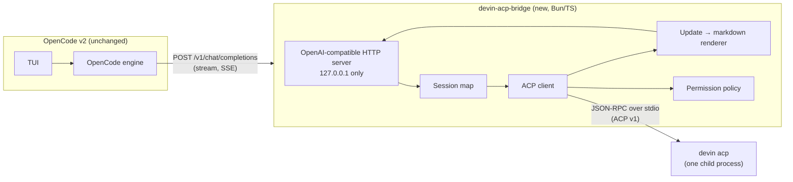

# Spec: Devin in the OpenCode TUI via a local ACP bridge (basic demo)

- **Status:** Demo complete. M0–M5 done (see §8 and §11).
- **Date:** 2026-11-04
- **Owner:** Jason Kang
- **Scope:** Personal tooling demo. Not a Tradify product change.

## 1. Problem

Devin CLI (3000.11.234) renders assistant replies poorly in the terminal: no syntax highlighting in fenced
code, and weak styling of headers, lists, bold and italics. OpenCode (v2.2.5) renders the same markdown well
in the same tmux pane, so the terminal is not the cause.

Devin can run as an ACP agent (`devin acp`). OpenCode can only be an ACP **agent**, not an ACP **client**,
so it cannot host `devin acp` directly. The upstream request for this (anomalyco/opencode#28991) was
auto-closed for inactivity, not rejected.

## 2. Goal

Type a prompt in the OpenCode TUI, have **Devin** do the work, and see Devin's reply rendered by OpenCode.

### Success criteria (demo)

1. A prompt sent from the OpenCode TUI reaches `devin acp`, and Devin's reply streams back into the TUI.
2. Markdown in the reply (headers, lists, bold, fenced code with highlighting) renders as well as a normal
   OpenCode reply.
3. A follow-up prompt in the same OpenCode session continues the same Devin session (Devin remembers context).
4. Devin's tool activity (file reads, edits, shell commands), plans and diffs are visible in the TUI.
5. No Devin tool call is approved automatically unless the user allowed it in advance.
6. Pressing escape/cancel in OpenCode cancels the Devin turn.

### Non-goals

- No fork of OpenCode. No change to the OpenCode source.
- No native OpenCode tool cards, diff/revert or snapshots for Devin's changes. Devin's activity appears as
  formatted text in the reply.
- ~~No OpenCode-side model picker for Devin models.~~ Added after the demo; see §6.10.
- No session list/resume across OpenCode restarts.
- No interactive permission prompt inside the OpenCode UI (see §6.5 and §10).
- Not a supported product. It relies on public interfaces of both tools, which can change.

## 3. Key design decision: a local OpenAI-compatible bridge, not a fork

Verified facts that drive the design:

| Fact | Source |
| --- | --- |
| OpenCode v2 custom providers accept `"package": "@opencode/ai/providers/openai-compatible"` with a `settings.baseURL`. | opencode.ai/v2/docs/providers ("Custom") |
| OpenCode v2 provider packages implement OpenCode's **own** `LanguageModel` (export `model(modelID, settings)`), not the Vercel AI SDK `LanguageModelV3`. | `packages/ai/src/provider-package.ts` on `anomalyco/opencode@dev` |
| So the existing `@mcpc-tech/acp-ai-provider` (AI SDK `LanguageModelV3`) cannot be plugged into OpenCode v2 directly. | Same as above |
| `devin acp` speaks ACP v1, newline-delimited JSON-RPC over stdio, and uses `devin auth login` credentials. | Devin CLI docs `reference/commands.mdx` (`devin acp`) |

The bridge therefore exposes an **OpenAI Chat Completions** endpoint on `127.0.0.1` and acts as an
**ACP client** to `devin acp`. OpenCode treats Devin as "just another model".

Alternatives considered:

| Option | Why not (for the demo) |
| --- | --- |
| Fork OpenCode and add an ACP client to its engine | Large; merge conflicts on every OpenCode release. |
| Custom OpenCode provider package (own `LanguageModel`) | Couples to OpenCode's internal Effect-based model API, which is not documented for third parties. Revisit after the demo. |
| Re-implement OpenCode's server API and use `opencode --server <url>` | Much larger API surface; undocumented. |
| CodeCompanion.nvim + `devin acp` | Works today without code. This spec is the OpenCode-specific alternative. |

## 4. Architecture



Request flow for one turn:

1. OpenCode sends the full conversation to `POST /v1/chat/completions` with `stream: true`.
2. The bridge maps the conversation to a Devin ACP session (§6.2). It creates the session on the first turn.
3. The bridge sends **only the newest user message** to Devin with `session/prompt`.
4. Devin streams `session/update` notifications. The bridge converts each one to markdown text (§6.3) and
   writes it as an SSE `chat.completion.chunk` with `delta.content`.
5. Devin may send `session/request_permission`. The bridge answers from its policy (§6.5).
6. When `session/prompt` resolves, the bridge sends a final chunk with `finish_reason` and `data: [DONE]`.

## 5. Components

### 5.1 `devin-acp-bridge` (new)

- **Runtime:** Bun (installed: 1.3.14) with TypeScript. Single entry file plus a few modules. Node 24 also works.
- **ACP library:** `@agentclientprotocol/sdk` (`ClientSideConnection`). The latest release (2.4.0) was
  published on 2026-11-02, which is less than 7 days ago. **Pin the newest version that is at least 7 days
  old**, and pin an exact version (no `^`).
- **HTTP:** `Bun.serve`. No framework.
- **Location:** `~/src/personal/devin-acp-bridge/` (personal repo, not a Tradify repo).

### 5.2 OpenCode configuration (no code change)

Global config `~/.config/opencode/opencode.jsonc`, or a project-level `opencode.jsonc`. Every field below was
checked against https://opencode.ai/config.json and exercised against the M0 stub (§11). The working copy is
`sandbox/opencode.jsonc`.

```jsonc
{
  "$schema": "https://opencode.ai/config.json",
  "providers": {
    "devin": {
      "name": "Devin (ACP bridge)",
      "package": "@opencode/ai/providers/openai-compatible",
      // Set per project: the bridge uses it as the Devin session cwd (§6.6).
      "headers": { "X-Devin-Cwd": "/absolute/path/to/project" },
      "settings": {
        "baseURL": "http://127.0.0.1:7317/v1",
        // Read the bridge token from its file; works in OpenCode's background service, unlike shell env.
        "apiKey": "{file:~/.config/devin-acp-bridge/token}",
        // Devin turns can be long and quiet while tools run.
        "chunkTimeout": false
      },
      "models": {
        "devin": {
          "name": "Devin",
          // Shows Devin's thoughts as OpenCode reasoning blocks.
          "compatibility": { "reasoningField": "reasoning_content" },
          // ACP reports no token usage; a large limit keeps OpenCode from compacting.
          "limit": { "context": 1000000, "output": 128000 }
        }
      }
    }
  },
  "agents": {
    "devin": {
      "description": "Send prompts to Devin through the local ACP bridge",
      "mode": "primary",
      // No "model" here: an agent model pin would override the model picked in /models.
      "permissions": [
        { "action": "edit", "resource": "*", "effect": "deny" },
        { "action": "shell", "resource": "*", "effect": "deny" }
      ]
    }
  },
  "compaction": { "auto": false },
  // Live Devin model list (§6.10). Options: baseURL, provider, exclude, refreshMinutes.
  "plugins": ["/absolute/path/to/devin-acp-bridge/opencode-plugin"]
}
```

Use: start the bridge, run `opencode`, and switch to the `devin` agent.

An agent `system: ""` and a model `capabilities.tools: false` do **not** stop OpenCode from sending its own
system prompt (about 80 KB) and tool definitions (§11). The bridge ignores both, so the config leaves those
settings out. The agent's edit/shell deny rules stay as a safety net.

## 6. Detailed design

### 6.1 Process lifecycle

- The bridge starts **one** `devin acp` child process on its first request and reuses it for all sessions.
- On start it sends `initialize` with `protocolVersion: 1` and
  `clientCapabilities: { fs: { readTextFile: false, writeTextFile: false }, terminal: false }`. Devin then uses
  its own file and shell tools, and the bridge does not touch the filesystem.
- If the child exits, the bridge clears all sessions, logs the exit code, and restarts the child on the next
  request. The in-flight OpenCode request gets an error chunk.
- On SIGINT/SIGTERM the bridge closes the child's stdin and exits.

### 6.2 Session mapping

OpenAI-style requests are stateless: OpenCode resends the whole history every turn. OpenCode does send its
session ID in the `x-opencode-session` header (also `x-opencode-session-id`, `x-session-id`) (§11).

- **Session key:** the `x-opencode-session` header. Fallback, if the header is missing: SHA-256 of the
  **first user message** text plus the cwd (§6.6).
- **First turn** (no entry for the key): `session/new` with `cwd` = an absolute path (§6.6) and
  `mcpServers: []`. Store `key → { sessionId, userTurns }`.
- **Next turn** (the request has exactly `userTurns + 1` user messages): reuse the stored `sessionId`. Send
  only the last `user` message.
- **Anything else** (OpenCode edited, retried or reverted history; or the bridge restarted, or `devin acp`
  restarted and the bridge forgot its sessions): start a new Devin session and send a transcript of the earlier
  user/assistant turns plus the latest user message (`transcriptPrompt` in `src/sessions.ts`).
- **System messages:** drop them. Devin has its own system prompt, and OpenCode's prompt describes tools that
  Devin does not have.
- **`tools` array:** ignore it. OpenCode sends its tool definitions on every main-chat request (§11).
- **Title requests:** answer locally, never send them to Devin (§7).
- **Image parts:** not implemented; only text parts reach Devin. Devin advertises
  `promptCapabilities.image: true`, so forwarding images as ACP `image` blocks is a possible follow-up.
- Sessions live in memory only. A bridge restart starts fresh Devin sessions.

### 6.3 ACP update → markdown mapping

Everything is emitted as **text content**. The bridge never emits OpenAI `tool_calls`, because OpenCode would
try to execute them.

| ACP `session/update` | Emitted markdown |
| --- | --- |
| `agent_message_chunk` (text) | The text, as is. |
| `agent_thought_chunk` | Emitted as `delta.reasoning_content`. OpenCode shows it as a reasoning block when the model sets `compatibility.reasoningField` (verified in M0). |
| First `tool_call`/`tool_call_update` for an ID | One line: `> **Run** \`<command>\`` for `execute` tools; otherwise `> **<title>** \`<path>\`` (up to 3 paths, relative to the cwd when inside it). |
| `execute` tool finishes (`completed` or `failed`) | The latest streamed output, first 20 lines, in a ` ```text ` fence. Devin streams output in `in_progress` updates and sends an empty `completed` update; `Exited with code N` placeholders are hidden. A non-zero `_meta.terminal_exit.exit_code` adds `> ✗ **<title>** exited with code N`. |
| Other tool `failed` | `> ✗ **<title>** failed: <first line of error>`. Skipped when the bridge itself rejected the permission. |
| Tool content of type `diff` | The path, then a ` ```diff ` block (unified diff, 3 lines of context, at most 80 lines). Rendered once per tool call and path, although Devin repeats it. |
| `plan` | `**Plan**` and a task list: `- [x]` completed, `- [ ] **…** _(in progress)_`, `- [ ]` pending. The first plan appears at once; the final plan appears at the end of the turn if it changed. |
| `usage_update` | Not shown. The last top-level one becomes the OpenAI `usage` (§6.4). |
| `available_commands_update`, `current_mode_update`, `config_option_update`, `session_info_update` | Not shown. |

Rules:

- Insert a blank line before and after every block element, so OpenCode's markdown parser does not merge a
  tool line into the previous paragraph.
- Track whether a fenced code block is open in the agent's own text. Never insert tool lines inside an open
  fence; queue them until the fence closes (splitting the chunk right after the closing fence line) or the
  turn ends (closing the fence first).

### 6.4 Stop reasons

| ACP `stopReason` | OpenAI `finish_reason` |
| --- | --- |
| `end_turn` | `stop` |
| `max_tokens` | `length` |
| `max_turn_requests` | `length` |
| `refusal` | `content_filter` |
| `cancelled` | `stop` (plus a final `_Cancelled._` line) |

`usage` comes from Devin's last top-level `usage_update` in the turn: `prompt_tokens` =
`_meta["cognition.ai/inputTokens"]` (falls back to `used`), `completion_tokens` =
`_meta["cognition.ai/outputTokens"]`. Updates with `_meta["cognition.ai/subagent_context"]` are ignored.

### 6.5 Permissions

`@mcpc-tech/acp-ai-provider` auto-selects the **first** permission option by default. The bridge must not do
that. Policy, in order:

1. **Devin's own config decides first.** Devin only sends `session/request_permission` for calls its own rules
   do not already allow or deny. Configure safe allows (reads, searches, `git status`, `dotnet build`, …) in
   `~/.config/devin/config.json` permissions.
2. **Bridge policy file** `~/.config/devin-acp-bridge/policy.json` (override with `DEVIN_BRIDGE_POLICY`),
   read again on every request, so edits apply without a restart:

   ```json
   {
     "rules": [
       { "command": "git push*", "decision": "reject" },
       { "command": "git *", "decision": "allow" },
       { "rule": "Exec(dotnet)", "decision": "allow" }
     ]
   }
   ```

   `command` matches `_meta["cognition.ai/editableCommand"]`, `rule` matches
   `_meta["cognition.ai/permissionRule"]`, `title` matches `toolCall.title`. Patterns are globs where only `*`
   is special. Every given field must match; a rule with no match field never matches. First match wins.
   A missing or invalid file means no rules.
3. **`allow` selects `allow_once` only.** Never `allow_always`, `allow_session`, `allow_always_global` or
   `switch_bypass`. If Devin offers no `allow_once`, the request is rejected.
4. **`allow` never covers a chained command.** A command containing `;`, `&`, `|`, `<`, `>`, a backtick, `$(`
   or a newline is rejected even when an allow rule matches, because `git *` would otherwise match
   `git status && rm -rf ~`.
5. **Default: reject.** Pick the option whose `kind` is `reject_once` (then `reject_always`). If none exists,
   return `outcome: "cancelled"`.
6. Every decision is emitted into the reply as `> **Permission** <allowed|rejected>: \`<command>\``.

An interactive approval UI inside OpenCode is out of scope for the demo (§10).

### 6.6 Working directory

The bridge needs an absolute `cwd` for `session/new`. OpenCode's requests do not carry its working directory
(`x-opencode-project` was `global` in M0). Demo approach, in order:

1. `X-Devin-Cwd` header. A project-level `opencode.jsonc` provider `headers` entry reaches the bridge
   (verified in M0). The bridge rejects a relative path or a path that does not exist.
2. Otherwise the bridge's own `cwd`. Start the bridge from the project directory.

### 6.7 Cancellation

If OpenCode closes the HTTP connection before the turn ends, the bridge sends `session/cancel` for that
session. The session stays busy until `session/prompt` resolves. A request for a busy session waits up to 5 s,
then gets HTTP 409.

If `devin acp` exits mid-turn, the open turn ends with
`_The bridge could not complete the Devin turn: …_`, the session map is cleared, and the next request starts a
new child and a new Devin session with the transcript (§6.2).

### 6.8 Security

- Bind to `127.0.0.1` only (hard-coded).
- Every `/v1/*` request needs `Authorization: Bearer <token>`, compared in constant time. The token is
  `DEVIN_BRIDGE_TOKEN` when set; otherwise the bridge creates `~/.config/devin-acp-bridge/token` once (mode
  `0600`). OpenCode reads the file with `"apiKey": "{file:~/.config/devin-acp-bridge/token}"`, which also
  works in OpenCode's background service, where shell variables are often missing. The token is never logged.
- The bridge never reads Devin credentials. `devin acp` uses its own `devin auth login` store.
- Prompts and replies are logged only with `DEVIN_BRIDGE_DEBUG=1`, to
  `~/.cache/devin-acp-bridge/bridge-debug.ndjson`, never to stdout.
- AI policy: no new AI vendor or model is involved. All inference still goes through Devin, the approved tool.

### 6.9 Endpoints

| Method | Path | Behaviour |
| --- | --- | --- |
| `GET` | `/v1/models` | Live Devin models (§6.10): `{ default_model, data: [{ id, name, object, owned_by }] }`, first entry `devin`. 502 when Devin cannot be asked. |
| `POST` | `/v1/chat/completions` | Streaming (SSE). Non-streaming requests: buffer the same output and return one completion. |
| `GET` | `/healthz` | `{ status, devin: "running" \| "stopped", sessions, busy }`. No auth. No session content. |

### 6.10 Model selection

OpenCode never calls `GET /v1/models` on an OpenAI-compatible provider (§11.1), so the model list comes from a
server plugin, `opencode-plugin/index.ts`.

- **Bridge catalog.** Devin reports its models only per session, as the `model` config option. The bridge reads
  them from every real `session/new`; while idle it refreshes at most every 15 min with a throwaway session
  that it deletes again. A `devin acp` restart clears the catalog.
- **Plugin.** On load (waiting up to 15 s for the first fetch) and every `refreshMinutes` (default 5) it fetches
  `/v1/models` with the bridge token (`DEVIN_BRIDGE_TOKEN`, else `~/.config/devin-acp-bridge/token`), drops
  IDs matching `exclude` (default `["fusion-*"]`), and registers the rest under the `devin` provider with
  `ctx.model.transform`. Each model is a copy of the configured `devin` model, so its limits and
  `compatibility` apply. A provider transform does not work: it cannot see providers defined in
  `opencode.jsonc`. A failed fetch keeps the current list and writes to
  `~/.cache/devin-acp-bridge/opencode-plugin.log`.
- **Per request.** The bridge reads `body.model`. `devin` means the model the session started with. Any other
  value is set with `session/set_config_option` (`configId: "model"`) when it differs from the session's
  current model, so switching mid-conversation applies to the next turn. Devin rejects an unknown value; the
  bridge returns 400 and deletes the session if it had just created it.
- **Thought level.** Each model ID includes its default thought level (`claude-opus-5-5-medium`,
  `swe-2-high`). Choosing a model resets `thought_level` to that default; the allowed levels differ by model,
  and `adaptive` has none (§11.4). The bridge does not expose thought levels; a future option is OpenCode
  model variants that set a body field the bridge applies with `configId: "thought_level"`.

## 7. Known side effects in OpenCode

| Behaviour | Effect | Mitigation for the demo |
| --- | --- | --- |
| OpenCode generates session titles with a model call to the same model, in the same session (verified in M0) | Would start a second Devin turn per session. | Bridge detects the title request and answers locally with the first five words of the user's first message. Detection: the system message starts with `You name conversations` **and** the request has no `tools`. |
| Context-usage indicator | Shows Devin's input tokens for the last turn against the configured `limit.context`. | Keep `limit.context` at Devin's context size (1,000,000 reported by `usage_update.size`) and `compaction.auto: false`. |
| Undo/revert in OpenCode | Reverts the transcript only, not Devin's file edits. | Document. Use git. |
| OpenCode's own tools/permissions | Sent to the bridge but not used. | Bridge ignores `tools`; agent denies edit/shell as a safety net. |

## 8. Milestones

| ID | Deliverable | Exit check |
| --- | --- | --- |
| M0 | **Done 2026-11-04.** Logging stub (`stub/server.ts`) and sandbox config (`sandbox/opencode.jsonc`). Captured three requests from `opencode run`. | Findings in §11. Open questions 1–4 in §10 answered. |
| M1 | **Done 2026-11-04.** Text and thought chunks streamed; title requests answered locally; Devin session reused per `x-opencode-session`; every permission request rejected and shown in the reply. | Criteria 1, 2, 3 and 5 met in `opencode run` (§11.2). TUI rendering confirmed by the user. |
| M2 | **Done 2026-11-04.** Hash fallback key; transcript replay into a new Devin session when history does not advance by exactly one user turn. | Unit tests; recovery after a `devin acp` kill remembered an earlier word (§11.3). |
| M3 | **Done 2026-11-04.** Tool lines, shell output, exit codes, diffs and plans (§6.3), fence-aware. | Criterion 4 (§11.3). |
| M4 | **Done 2026-11-04.** Policy file (§6.5): allow once, chained commands never allowed, default reject. | Criterion 5: allowed `touch` ran, other `touch` rejected (§11.3). |
| M5 | **Done 2026-11-04.** Bearer token, `/healthz`, cancel on disconnect, busy wait, child-exit handling, `usage` mapping. | Criterion 6 and child-kill recovery (§11.3). |
| M6 | **Done 2026-11-04.** Model selection (§6.10): live `/v1/models`, OpenCode plugin with periodic refresh and fusion models hidden, per-request model switch. | `opencode models` lists 22 `devin/*` models; `-m` switches reach Devin (§11.4). |
| M7 | **Done 2026-11-04.** Plugin-managed bridge (§11.6): the plugin starts one shared bridge on a random port with OpenCode's embedded Bun, registers the provider per project, and replaces the bridge when its build changes. Manual mode stays behind the `baseURL` option. | §11.7. |

## 9. Test plan

- **Unit (bun test, 79 tests):** model catalog and exclude filter (`models.test.ts`); session keys, history check and transcript (`sessions.test.ts`); title
  detection and stop reasons (`openai.test.ts`); every rendered update type, fence tracking and usage
  (`render.test.ts`); unified diff (`diff.test.ts`); policy matching, chained-command guard, `switch_bypass`
  never selected, policy loading (`permissions.test.ts`); token resolution and bearer check (`auth.test.ts`).
- **Contract:** not done. Candidate: replay `bridge-debug.ndjson` captures through `TurnRenderer`.
- **Manual end-to-end in tmux:**
  1. Ask Devin to show a C# method with a fenced block. Confirm highlighting.
  2. Ask a follow-up that depends on the first answer. Confirm continuity.
  3. Ask Devin to edit a scratch file. Confirm the tool line, the diff block, and the permission line.
  4. Start a long task and cancel it from OpenCode. Confirm Devin stops.
  5. Kill `devin acp`. Confirm the next prompt works.

## 10. Open questions

1. ~~Does `capabilities.tools: false` stop OpenCode sending `tools`?~~ **No.** 9 tools were still sent. The
   bridge ignores them.
2. ~~Does OpenCode show `reasoning_content` deltas?~~ **Yes**, with `compatibility.reasoningField`.
3. ~~Can project-level config set provider `headers`?~~ **Yes.** `X-Devin-Cwd` arrived.
4. ~~Which other requests does OpenCode make?~~ **Title generation** on the first turn. No summary or warming
   requests in M0 (warming is off by default; auto-compaction is off in the sandbox config). Not yet observed:
   manual `/compact`, subagent calls.
5. Is an interactive permission prompt worth a follow-up? Option: emit the request as text, end the turn,
   and treat the user's next message ("allow" / "deny") as the answer. This needs ACP to keep the request
   open across HTTP requests.
6. After the demo: upgrade to a real OpenCode provider package (§3) to get native tool cards, or propose ACP
   client support upstream with reference to anomalyco/opencode#28991.

## 11. Findings

### 11.1 M0 (2026-11-04)

Setup: `bun run stub` on `127.0.0.1:7317`; two turns with
`opencode --standalone run --format json --thinking …` (OpenCode 2.2.5) from `sandbox/`. Raw captures are in
`captures/` (gitignored).

| # | Request | Observed |
| --- | --- | --- |
| 001 | Turn 1, main chat | `stream: true`, `stream_options.include_usage: true`, `max_completion_tokens: 128000`. Messages: 1 `system` (about 80 KB OpenCode harness prompt) + 1 `user`. 9 `tools`: glob, grep, question, read, skill, subagent, webfetch, websearch, execute (edit/shell absent because the agent denies them). |
| 002 | Title generation | Same model and same session headers. System prompt starts `You name conversations…`. One `user` message starting `Here is the first message of the conversation:`. No `tools`, no `max_completion_tokens`. |
| 003 | Turn 2, main chat | Full history: system, user, assistant, user. The previous assistant message carries `reasoning_content`. User content is a plain string. |

Headers on every request: `authorization: Bearer <DEVIN_BRIDGE_TOKEN>`, `x-devin-cwd` (from config),
`x-opencode-session`, `x-opencode-session-id`, `x-session-id`, `x-session-affinity` (all the OpenCode
session ID), `x-opencode-client: cli`, `x-opencode-project: global`, `user-agent: opencode/latest/2.2.5/cli`,
`traceparent`.

Rendering: OpenCode accepted the stub's SSE stream, produced a `reasoning` part from `reasoning_content`, and
a `text` part with the markdown intact. TUI rendering was not checked in M0 (the run used `--format json`).

### 11.2 M1 (2026-11-04)

Implementation: `src/server.ts` (HTTP + SSE), `src/devin.ts` (one `devin acp` child, ACP client),
`src/openai.ts` (request parsing, title detection, chunk building), `src/permissions.ts` (default reject).
ACP SDK pinned to `@agentclientprotocol/sdk@2.0.2` (2.1.0+ were under 7 days old). `stub/probe.ts` runs
`initialize` and `session/new` only, with no prompt.

End-to-end results with `opencode --standalone run` (OpenCode 2.2.5, Devin CLI 3000.11.234):

| Check | Result |
| --- | --- |
| Markdown reply (heading, list, bold, C# fence) | Arrived intact as an OpenCode `text` part. |
| Follow-up with `--continue` ("what word did I ask you to remember?") | Correct answer. Devin log shows 1 `session/new`, 2 `session/prompt`. |
| Title request | Answered locally; never reached Devin. |
| `touch /tmp/devin-bridge-perm-test` | Rejected; reply shows `> **Permission** rejected: \`touch /tmp/devin-bridge-perm-test\``; file not created. |

Facts about `devin acp` learned in M1:

- `initialize` needs no `authenticate` call when `devin auth login` credentials exist. It advertises one auth
  method, `devin-browser`.
- `devin acp` writes verbose logs to stderr. The bridge appends them to
  `~/.cache/devin-acp-bridge/devin-acp.log`.
- New sessions start in mode `accept-edits` (Devin CLI's "Code" mode): file edits apply without a permission
  request; shell commands and other tools ask. Available modes: `accept-edits`, `smart`, `ask`, `plan`,
  `bypass`.
- Sessions persist (`cognition.ai/persistOnCreate`), so bridge sessions appear in the Devin session list.
- Permission requests carry no `toolCall.title`. The command is in `_meta["cognition.ai/editableCommand"]`
  and the rule in `_meta["cognition.ai/permissionRule"]`. Options include `allow_session`, `allow_always`,
  `allow_always_global` and `switch_bypass` (all `kind: allow_always`) and `reject_once`. The bridge must
  never pick by position.
- Devin also sends `usage_update` (token usage) and `session_info_update` (including a generated session
  title). M5 maps `usage_update` to OpenAI `usage`. Devin's title is still unused.
- `DEVIN_BRIDGE_DEBUG=1` writes every ACP update and permission request to
  `~/.cache/devin-acp-bridge/bridge-debug.ndjson`. It contains prompt and reply text; leave it off by default.

### 11.3 M2–M5 (2026-11-04)

End-to-end runs used a second bridge on port 7318 (`e2e/opencode.jsonc`, `e2e/policy.json`,
`DEVIN_BRIDGE_TOKEN=e2e-token`), so the user's bridge on 7317 kept running.

| Check | Result |
| --- | --- |
| `/healthz` without token; `/v1/models` with no, wrong and right token | 200; 401; 401; 200. |
| Plan + read + edit + shell in one turn | First plan, `> **Read file** \`scratch.txt\``, `> **Run** \`echo bridge-ok\`` with a `text` fence holding `bridge-ok`, `> **Edit file**` with a `diff` block, final plan. Without M3 the text around tool calls ran together ("…check this.I changed…"). |
| Policy `touch /tmp/devin-bridge-allow-*` = allow | `touch /tmp/devin-bridge-allow-test` allowed and the file was created; `touch /tmp/devin-bridge-perm-test` rejected and not created. |
| Kill the OpenCode client 15 s into a long reply | Devin log shows `session/cancel`; `/healthz` went from `busy: 1` to `busy: 0`; the next `--continue` prompt reused the same Devin session. |
| `kill -9` the `devin acp` child mid-turn | Turn ended with `_The bridge could not complete the Devin turn: ACP connection closed_`; `/healthz` showed `devin: stopped, sessions: 0`. The next `--continue` prompt started a new child and session, got the transcript, and answered with the word set two turns earlier. |

Facts about `devin acp` learned in M3:

- Tool updates for one ID arrive as `tool_call` then several `tool_call_update`s. `title`, `kind`,
  `locations` and `rawInput` come on the first; later updates carry only what changed.
- Shell (`kind: execute`) output arrives in `in_progress` updates as text content. The last of these has
  `_meta.terminal_exit.exit_code`. The `completed` update has no content. A silent command reports
  `Exited with code 0` as its output. The first `tool_call` also carries a `resource` preview of the command.
- Edit tools send a `diff` with the **whole file** as `oldText`/`newText`, on the `tool_call` and again on an
  `in_progress` update.
- Devin's own rules already allow some commands (for example `echo`), so those never reach the bridge policy.
- Devin may run tool calls in parallel, so tool lines can appear in a different order from the plan.

### 11.4 M6 (2026-11-04)

| Check | Result |
| --- | --- |
| `GET /v1/models` | 51 entries (`devin` + 50 Devin models) in about 1.2 s; the throwaway session was deleted. |
| `opencode --standalone models` from `e2e/` | 22 `devin/*` entries (`devin` + 21 models); no `fusion-*`. |
| Plugin with `ctx.provider.transform` | No effect: `editor.get("devin")` was `undefined` for the config-defined provider. `ctx.model.transform` works. |
| `-m devin/swe-2-high`, then `--continue -m devin/claude-sonnet-5-5-medium` | Both turns answered; Devin log shows two `apply_model_change`; `config_option_update` showed `swe-2-high` with `thought_level: high`. |
| Chat with `model: "not-a-model"` | HTTP 400 `Devin rejected model "not-a-model": Invalid params`; the new session was deleted. |

Facts about Devin models:

- Display names in the `model` option have no effort suffix ("Claude Opus 5.5", "SWE-2"); the ID carries the
  model's default thought level.
- Changing `model` resets `thought_level` to that model's default and changes its allowed values: SWE-2 offers
  medium/high/max, Sonnet 5.5 low–max, Gemini 3.8 Flash low–high, `adaptive` none.
- `devin models` (CLI) lists different IDs (one per effort, for example `swe-2-medium`) and has no JSON output,
  so the bridge uses the ACP option instead.

### 11.5 Plugin-managed bridge spike (2026-11-04)

Goal: no manual `bun run`. The plugin should start the bridge and register the provider, like an editor
starting a language server. Probe: `spike/plugin-probe/index.ts`, loaded by `spike/project-a` and
`spike/project-b`, pointed at the logging stub on port 7319 (no Devin turns).

| Question | Result |
| --- | --- |
| Bun APIs in the plugin runtime? | Yes. `Bun` global with `Bun.serve`; Bun 1.4.4 is embedded in the OpenCode binary. `Bun.serve` on port 0 inside the plugin answered. `process.execPath` is the `opencode` binary. |
| Can the plugin start a Bun child without a separate Bun install? | Yes. `BUN_BE_BUN=1 <opencode binary> run file.ts` runs the file as Bun 1.4.4. |
| Can the plugin register the provider at runtime, with no provider in `opencode.jsonc`? | Yes. `ctx.provider.transform(editor => editor.add({ info, models }))` with `package: openai-compatible`, `settings.baseURL`, `settings.apiKey` and `headers`. `opencode models` listed it; a chat request reached the stub with `Authorization: Bearer <apiKey>`. |
| Per-project working directory? | Yes. One `opencode serve` process ran **one plugin instance per directory**. Each registered `X-Devin-Cwd: ctx.location.directory`; requests from `project-a` and `project-b` carried their own directory. |
| Shared module state between instances? | **No.** Each directory instance re-imports the module (`moduleLoadedAt` differs, counter is 1 in both). A shared bridge needs coordination outside process memory. |
| Service lifetime | The user's `opencode serve --service` has run since the previous day (parent PID 1). A plugin-started bridge would live as long as the service. |
| `opencode plugin add github:…` installs dependencies? | Not tested: needs a remote repository, and `plugin add` edits the global config. |

### 11.6 Proposed design: plugin-managed bridge

- **One bridge per machine.** Each plugin instance calls `ensureBridge()`: read
  `~/.cache/devin-acp-bridge/bridge.json` (`{ port, pid }`) and check `/healthz`. If nothing answers, take a
  lock file (exclusive create), start the bridge as a detached child with
  `BUN_BE_BUN=1 <process.execPath> run <plugin dir>/src/server.ts`, wait for `/healthz`, write `bridge.json`.
  Other instances reuse it.
- **Random port.** The bridge listens on port 0 and reports the chosen port in `bridge.json`.
- **Token.** Keep the `0600` token file; the plugin passes it as `settings.apiKey`. (An in-memory token would
  differ between plugin instances, which do not share memory.)
- **Provider from the plugin.** The plugin registers the `devin` provider, the `devin` model template, the live
  model list and `X-Devin-Cwd: ctx.location.directory`. Users then add only the plugin and the `devin` agent.
- **Restart.** If `/healthz` fails during a refresh, the next `ensureBridge()` starts a new bridge.
- **Install.** `opencode plugin add github:<owner>/devin-acp-bridge`, then `opencode service restart`. Still to
  verify: dependency installation and the package entry point for a Git install.
- **Keep the manual mode.** `bun run start` and the static config stay supported for people who do not use the
  OpenCode service.

### 11.7 M7 (2026-11-04)

Implementation: `src/managed.ts` (`buildId`, state file, lock file, `ensureBridge`), bridge writes
`DEVIN_BRIDGE_STATE` and reports `pid`/`build` in `/healthz`, plugin managed mode in `opencode-plugin/index.ts`.
Test project: `managed-e2e/project-{a,b}` (plugin and agent only, no provider).

| Check | Result |
| --- | --- |
| `opencode --standalone models` with no bridge running | Plugin started a bridge on a random port (62097); 22 `devin/*` models; process is `opencode run …/src/server.ts` with parent PID 1. |
| `pwd` turn from `project-a`, then from `project-b` | Each printed its own directory; both used the same bridge PID. |
| Edit a file in `src/`, run again | Plugin stopped the old bridge and started a new one with a new build ID and port. |
| `kill` the managed bridge | It removed its own state file. |
| `sandbox/` (plugin with `baseURL` = 7317) | 22 models from the user's manual bridge; no managed bridge started. |

Not verified: `opencode plugin add github:…` (needs a remote) and `npm install` instead of `bun install`.

## 12. References

- Devin CLI docs (local): `~/.local/share/devin/cli/_versions/3000.11.234/share/devin/docs/reference/commands.mdx` (`devin acp`)
- ACP specification: https://agentclientprotocol.com
- OpenCode v2 providers: https://opencode.ai/v2/docs/providers/
- OpenCode v2 config: https://opencode.ai/v2/docs/config/ and schema https://opencode.ai/config.json
- OpenCode v2 provider package contract: `packages/ai/src/provider-package.ts` on `anomalyco/opencode@dev`
- Prior art (AI SDK, not usable directly in OpenCode v2): `@mcpc-tech/acp-ai-provider`, `packages/acp-ai-provider/src/language-model.ts` in `mcpc-tech/mcpc`
- Upstream feature request: https://github.com/anomalyco/opencode/issues/28991
